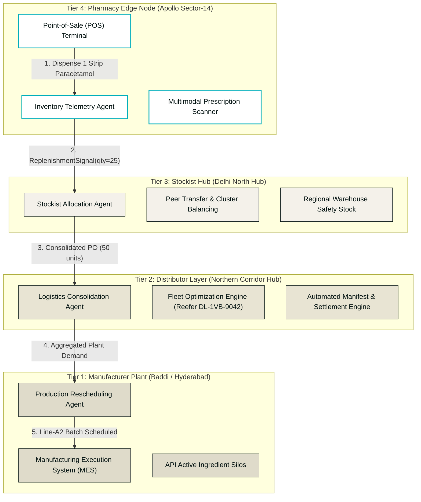

# MediFlux (NexusChain) — AI-Native Autonomous Pharmaceutical Supply Chain Network

[](https://github.com/harsh/mediflux)
[](https://www.python.org/)
[](https://fastapi.tiangolo.com/)
[](https://github.com/langchain-ai/langgraph)
[](https://vitejs.dev/)
[](./Design.md)
[](./LICENSE)

> **Core Value Proposition**: **Instantaneous Single-Unit Retail Demand Propagation**  
> When **1 single strip of medicine** is dispensed at a neighborhood pharmacy counter point-of-sale (POS), an automated multi-agent cascade propagates demand up the supply chain across four tiers in under 50 milliseconds:
> 
> $$\text{Pharmacy Edge Node} \longrightarrow \text{Stockist Hub} \longrightarrow \text{Distributor Layer} \longrightarrow \text{Manufacturer Plant}$$

---

## 1. RFP Capability to Implementation Mapping

| RFP Requirement & Domain | Architectural Module | Core Files & Implementation |
|---|---|---|
| **1-Strip Retail Demand Propagation** | 4-Tier Automated LangGraph Cascade | `backend/app/graphs/cascade.py`, `backend/app/api/v1/endpoints/cascade.py` |
| **Pharmacy Inventory Telemetry** | Edge POS Agent & FEFO Evaluation | `backend/app/agents/pharmacy_agent.py`, `backend/app/tools/pharmacy_tools.py` |
| **Stockist Hub Balancing & Allocation** | Dynamic Stockist Allocation Agent | `backend/app/agents/stockist_agent.py`, `backend/app/tools/stockist_tools.py` |
| **Distributor Fleet & Logistics Routing** | Logistics Consolidation & Route Dispatch | `backend/app/agents/distributor_agent.py`, `backend/app/agents/settlement_agent.py` |
| **Manufacturer Plant Scheduling** | MES Line Rescheduling & Raw Material Check | `backend/app/agents/manufacturer_agent.py`, `backend/app/tools/manufacturer_tools.py` |
| **Self-Evolving Adapter Forge** | Zero-Code ERP Ingestion & AST Guard | `backend/app/graphs/forge.py`, `backend/app/modules_runtime/guard.py` |
| **Autonomous Regulatory Pipeline** | CDSCO Gazette Ingestion & DPCO Hot-Swap | `backend/app/graphs/regulatory.py`, `backend/app/modules_runtime/registry.py` |
| **Human-in-the-Loop (HITL) Governance** | Approval Dashboard & Expiration Workers | `backend/app/api/v1/endpoints/hitl.py`, `backend/app/workers/hitl_expiry_worker.py` |
| **Sovereign Multimodal Prescription Scanner**| Zero-PII OCR & MCI Doctor Verification | `backend/app/graphs/prescription.py`, `backend/app/api/v1/endpoints/prescriptions.py` |
| **IoT Cold-Chain Telemetry & Excursions** | Arrhenius Kinetic Degradation Engine | `backend/app/graphs/coldchain.py`, `backend/app/api/v1/endpoints/coldchain.py` |
| **Natural Language Network Copilot** | Grounded Citations & pgvector RAG | `backend/app/graphs/copilot.py`, `backend/app/api/v1/endpoints/copilot.py` |
| **Tamper-Evident Cryptographic Ledger** | Forward SHA-256 Monotonic Hash Chain | `backend/app/core/audit_ledger.py`, `backend/app/api/v1/endpoints/audit.py` |
| **Zero-LLM Fast Event Ingestion** | In-Process EventBus & Outbound Webhooks | `backend/app/events/bus.py`, `backend/app/services/webhooks.py` |
| **Real-Time Streaming** | Server-Sent Events (SSE) with Node Scoping | `backend/app/events/sse.py`, `backend/app/api/v1/endpoints/stream.py` |
| **Multi-Provider LLM Resilience** | NVIDIA NIM + OpenRouter + Ollama Fallback | `backend/app/llm/router.py`, `backend/app/llm/fault.py`, `backend/app/llm/cache.py` |
| **Native Desktop Packaging** | Cross-Platform Desktop Bundle | `desktop/src-tauri/`, `docs/DESKTOP_BUILD.md` |
| **Autonomous Mobile & Edge Field POS** | Expo 51 + TypeScript + Offline Resilience | `mobile/`, `docs/MOBILE.md` |

---

## 2. 4-Tier Network Architecture



---

## 3. Quick Start Guide

### Prerequisites
- **Python**: 3.11 or 3.12 (`python --version`)
- **Node.js**: 18+ and npm (`node --version`, `npm --version`)
- **Local Ollama (Optional)**: For air-gapped sovereign inference (`ollama serve`)

### 1. Configure Environment
```powershell
cp .env.example .env
```
*(All 21 environment variables are pre-configured with functional development defaults and Supabase cloud connectivity.)*

### 2. Single-Command Launch (Windows PowerShell)
```powershell
.\scripts\start-all.ps1
```
*(On Linux / macOS: `./scripts/start-all.sh`)*

- **Backend API**: `http://localhost:8000`
- **Interactive OpenAPI 3.1.0 Docs**: `http://localhost:8000/docs`
- **Frontend Operational UI**: `http://localhost:5173`

---

## 4. Running the 10-Step Interactive Scripted Demo

The scripted demo runner executes all 10 presentation acts deterministically using the zero-network pre-recorded LLM cache (< 50ms per step):

```powershell
# Reset state to clean baseline and execute 10-act presentation sequence
python -m scripts.reset_demo
python -m scripts.run_demo --mode replay
```

### 10-Step Presentation Sequence:
- **Act 1**: Instantaneous Single-Unit POS Sale → 4-Tier Automated Demand Cascade
- **Act 2**: Self-Evolving Adapter Forge → Zero-Code Legacy Ingestion with AST Guard
- **Act 3**: Autonomous Regulatory Pipeline → DPCO Price Ceiling Zero-Downtime Hot-Swap
- **Act 4**: Sovereign Multimodal Prescription Scanner → CDSCO Schedule H Audit (Zero PII Leaked)
- **Act 5**: Cold-Chain IoT Telemetry → Arrhenius Shelf-Life Auto-Quarantine & Rebalance
- **Act 6**: Natural Language Network Copilot & Cryptographic Audit Verification
- **Act 7**: Real-Time Canonical Event Ingestion & Server-Sent Events (SSE) Stream
- **Act 8**: Dynamic Business Module Registry & Version Rollback Inspection
- **Act 9**: OpenAPI 3.1.0 Contract Schema & Developer Hub Validation (85 Endpoints)
- **Act 10**: Multi-Tier Network Topology & Real-Time Operational KPIs

---

## 5. Automated Verification & Quality Standards

MediFlux enforces strict quality guardrails defined in `AGENTS.md`:
- **100% Type Hints**: Across all Python modules and Pydantic v2 schemas.
- **Zero Forbidden Tech**: Strictly zero Redis, zero Docker, zero WASM, zero Kafka in MVP code.
- **Empirical Accuracy**: Zero hardcoded or estimated benchmark metrics.

```powershell
# Run backend test suite (276 tests passing)
cd backend
.\venv\Scripts\pytest.exe

# Run backend linter (0 errors / 0 warnings)
.\venv\Scripts\ruff.exe check .

# Run secrets scanner (0 leaked credentials)
python -m scripts.check_secrets

# Build frontend production bundle (0 errors)
cd ..\frontend
npm run build
```

---

## 6. Comprehensive Documentation Index

All technical documentation is organized under the [`docs/`](./docs) directory:

| Document | Content & Purpose |
|---|---|
| [`docs/BENCHMARKS.md`](./docs/BENCHMARKS.md) | **Empirical Performance Benchmarks**: Live measured single-event p50 latencies across concurrency tiers, batch processing throughput, cascade latencies, and hardware specs. |
| [`docs/TOKEN_AND_COST_REPORT.md`](./docs/TOKEN_AND_COST_REPORT.md) | **Token Telemetry & Cost Modeling**: Per-agent token consumption profile, 4-tier cascade budget (1,357 tokens), and multi-tier scaling cost matrix ($0.00/mo on free providers). |
| [`docs/ARCHITECTURE.md`](./docs/ARCHITECTURE.md) | **Comprehensive System Architecture**: Mermaid diagrams, 6 LangGraph state machines, 18 domain agents inventory, and Dynamic Module Registry. |
| [`docs/POST_MVP.md`](./docs/POST_MVP.md) | **Post-MVP Evolution Roadmap**: EventBus to Kafka, AST to WASM/Firecracker, Redis cluster, Sovereign Llama-3.3-70B Indian cloud deployment, and honest MVP disclosure matrix. |
| [`docs/SECURITY_AND_COMPLIANCE.md`](./docs/SECURITY_AND_COMPLIANCE.md) | **Security & Statutory Compliance**: Multi-tenant RLS, SHA-256 API keys, HMAC webhooks, DPDP Act 2023 patient privacy, and cryptographic audit hash chain. |
| [`docs/DEMO_SCRIPT.md`](./docs/DEMO_SCRIPT.md) | **Timed 10-Step Demo Guide**: 8–10 minute narrative walkthrough with exact curl commands, UI navigation, and narrator talking points. |
| [`docs/openapi.json`](./docs/openapi.json) | **OpenAPI 3.1.0 Specification**: Machine-readable JSON contract covering all 85 REST routes. |
| [`docs/API_GUIDE.md`](./docs/API_GUIDE.md) | **REST API Developer Guide**: Endpoint reference, authentication headers, error codes, and curl examples. |
| [`docs/MCP_SERVER.md`](./docs/MCP_SERVER.md) | **Model Context Protocol (MCP) Server**: Tools and resources exposed to AI IDE agents. |
| [`docs/DESKTOP_BUILD.md`](./docs/DESKTOP_BUILD.md) | **Desktop Application Build Guide**: Tauri 2.0 native packaging for Windows, macOS, and Linux. |
| [`docs/MOBILE.md`](./docs/MOBILE.md) | **Autonomous Mobile Application Guide**: Complete guide to React Native (Expo 51) app, offline resilience, test matrix, failure-injection controls, and UI screenshots. |
| [`docs/HOW_AI_BUILT_THIS.md`](./docs/HOW_AI_BUILT_THIS.md) | **AI Engineering Build Log**: Complete chronological audit log of Tasks 1 through 30 across Phases 1 through 8. |
| [`docs/specs/`](./docs/specs/) | **Engineering Specifications**: Individual formal specifications for Tasks 2 through 30. |

---

## 7. Deferred Items List (Post-MVP Roadmap)

Per `AGENTS.md`, the following technologies were strictly excluded from the MVP to eliminate runtime bloat and ensure zero-friction onboarding:

| Deferred Technology | MVP Solution (Verified Today) | Enterprise Post-MVP Roadmap |
|---|---|---|
| **Redis** | In-memory dictionaries & Supabase tables | Redis Cluster for sliding-window rate limiting & distributed locks |
| **Docker** | Bare-metal local execution with standard `venv` and `npm` | Containerized microservices orchestrated via Kubernetes |
| **WASM Sandbox** | Static Python AST analysis (`guard.py`) | Wasmtime WebAssembly sandboxes with hardware memory limits |
| **Kafka / Redpanda** | Asynchronous in-process `EventBus` (`bus.py`) | Distributed Redpanda cluster with partitioned consumer groups |

*(Detailed migration specifications for each item are documented in [`docs/POST_MVP.md`](./docs/POST_MVP.md).)*

---

## 8. How AI Built This

MediFlux was designed, implemented, and verified using an autonomous AI-assisted multi-agent engineering workflow across **30 tasks** and **8 phases**:
- **Phase 1**: System Architecture & Foundational Scaffolding (Tasks 1–4)
- **Phase 2**: Core Data Plane & Event Ingestion (Tasks 5–8)
- **Phase 3**: Multi-Agent Demand Propagation Cascade (Tasks 9–14)
- **Phase 4**: Advanced Cognitive Capabilities (Tasks 15–20)
- **Phase 5**: Production Readiness & Observability (Tasks 21–24)
- **Phase 6**: Frontend Real-Time Operational UI (Tasks 25–27)
- **Phase 7**: Enterprise Packaging & Desktop Client (Task 28)
- **Phase 8**: Hardening, Benchmarking & MVP Submission (Tasks 29–30)

For the complete technical breakdown of architectural decisions, prompts, and verification evidence, see [`docs/HOW_AI_BUILT_THIS.md`](./docs/HOW_AI_BUILT_THIS.md).

---

## 9. License

This repository and its contents are proprietary submission artifacts for the Autonomous Supply Chain RFP evaluation. All rights reserved.
