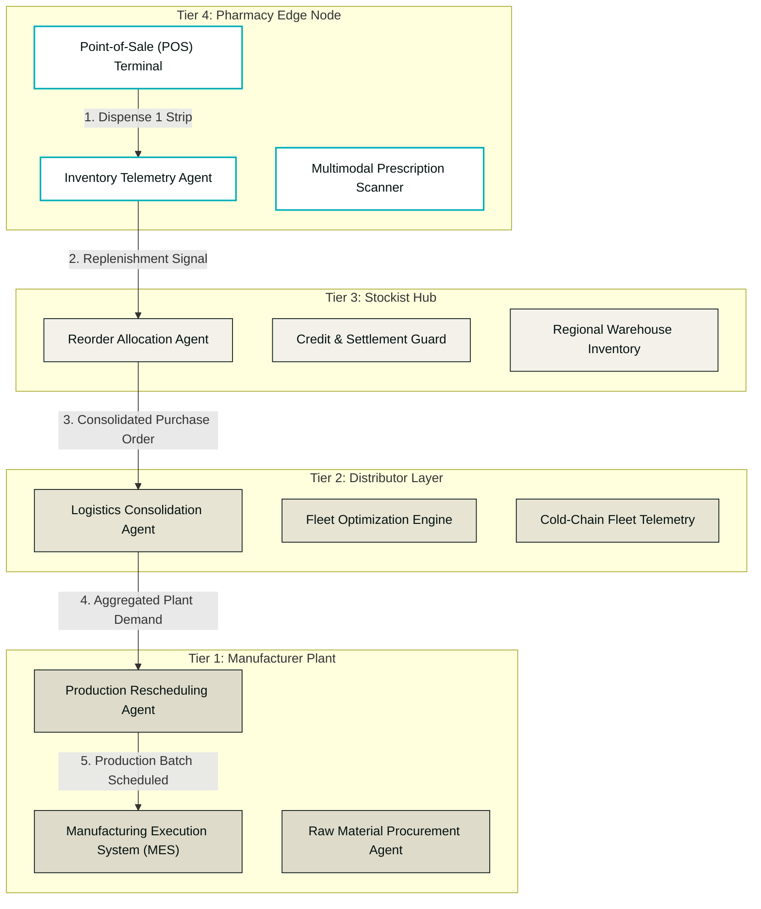
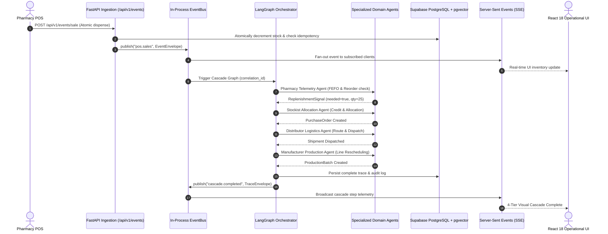

# MediFlux / NexusChain — System Architecture & Engineering Specification

> **Document Status**: Production Verified (v1.0.0-MVP)  
> **System Classification**: AI-Native Autonomous Pharmaceutical Supply Chain Network  
> **Core Value Proposition**: Instantaneous Single-Unit Retail Demand Propagation across Four Tiers

---

## 1. System Overview & Architectural Philosophy

**MediFlux** (referred to in RFP documentation as **NexusChain**) is an AI-native hyper-connected pharmaceutical supply chain operating across India. In traditional pharmaceutical logistics, retail dispensing data is trapped at fragmented point-of-sale (POS) counters, causing massive bullwhip oscillations, frequent stockouts of life-critical medicines, and delayed response to CDSCO regulatory recalls.

MediFlux solves this through **instantaneous single-unit demand propagation**:
When 1 strip of medicine is dispensed at a neighborhood pharmacy counter, an automated multi-agent cascade propagates demand up the supply chain across four tiers:

$$\text{Pharmacy Edge Node} \longrightarrow \text{Stockist Hub} \longrightarrow \text{Distributor Layer} \longrightarrow \text{Manufacturer Plant}$$

### Non-Negotiable MVP Guardrails (from `AGENTS.md`)
To maintain zero runtime bloat, deterministic replayability, and frictionless local onboarding:
- **No Redis**: All caching and in-process queuing is handled via Python in-memory state, local hash dictionaries, and Supabase tables.
- **No Docker**: The application runs bare-metal locally with standard Python virtual environments (`venv`) and Node runtimes.
- **No WASM**: Safety-critical code inspection is executed via static Python AST analysis and runtime inspection (`modules_runtime/guard.py`).
- **No Apache Kafka / Redpanda**: Decoupled asynchronous publish-subscribe is orchestrated via an in-process asynchronous `EventBus` backed by Supabase tables and Server-Sent Events (SSE).

---

## 2. 4-Tier Network Topology



---

## 3. Event Ingestion, State Machine & Streaming Architecture



---

## 4. LangGraph Multi-Agent State Machines (6 Operational Graphs)

MediFlux orchestrates complex, multi-agent workflows using **LangGraph** state machines with in-process checkpointers:

| Graph Module | State Machine Purpose | Nodes & Transitions | Persistence / Output |
|---|---|---|---|
| **`app.graphs.cascade`** | 4-Tier Automated Demand Propagation | `pharmacy_node` → `stockist_node` → `distributor_node` → `manufacturer_node` | `demand_signals`, `orders`, `shipments`, `production_batches` |
| **`app.graphs.forge`** | Self-Evolving Legacy Adapter Synthesis | `analyze_schema` → `synthesize_code` → `ast_security_guard` → `test_sandbox` → `register_module` | Dynamic Python module registered in memory and `adapters` table |
| **`app.graphs.regulatory`** | Autonomous Regulatory Gazette Pipeline | `parse_gazette` → `diff_analyzer` → `generate_patch` → `test_suite_runner` → `create_hitl_task` | Staged module in `modules` table & pending task in `hitl_tasks` |
| **`app.graphs.prescription`** | Sovereign Multimodal Prescription Scanner | `privacy_redact` → `ocr_extraction` → `cdsco_schedule_audit` → `doctor_registry_verify` → `dispense_decision` | `prescriptions` and `compliance_logs` records (zero PII stored) |
| **`app.graphs.coldchain`** | IoT Excursion & Arrhenius Auto-Quarantine | `ingest_telemetry` → `arrhenius_kinetic_calc` → `quarantine_evaluator` → `rebalance_dispatch` | `quarantine_actions`, `inventory` status updates, emergency transfers |
| **`app.graphs.copilot`** | Natural Language Network Copilot | `intent_classify` → `rag_vector_search` → `grounded_synthesis` → `audit_proof_generator` | Grounded textual response with exact entity citations and cryptographic hash |

---

## 5. Agent & Tool Inventory (18 Production Agents)

Every agent in MediFlux inherits from `BaseAgent`, exposes typed Pydantic v2 schemas, and utilizes strictly scoped domain tools:

| # | Agent Name | Tier / Domain | Core Responsibility | Primary Tools Used |
|:---:|---|---|---|---|
| 1 | `InventoryTelemetryAgent` | Pharmacy Edge | Evaluates local stock, velocity, and FEFO expiry | `get_inventory`, `get_sales_velocity`, `check_fefo` |
| 2 | `StockistAllocationAgent` | Stockist Hub | Reorders allocation across pharmacies and checks credit | `get_stockist_stock`, `check_credit_limit`, `create_po` |
| 3 | `DistributorLogisticsAgent` | Distributor Layer | Fleet dispatch, route clustering, cross-docking | `get_fleet_status`, `calculate_route`, `create_shipment` |
| 4 | `ManufacturerProductionAgent` | Manufacturer | Plant scheduling, raw material availability | `get_production_capacity`, `check_api_stock`, `schedule_batch` |
| 5 | `AdapterForgeAgent` | Integration | Synthesizes Python translation code for legacy ERPs | `ast_validator`, `sandbox_executor`, `register_adapter` |
| 6 | `GazetteIngestionAgent` | Regulatory | Scrapes and ingests official CDSCO/NPPA gazette notices | `fetch_gazette`, `parse_pdf_text`, `extract_schedules` |
| 7 | `RegulatoryAnalysisAgent` | Regulatory | Computes DPCO price ceiling delta and impacted SKUs | `get_drug_schedules`, `compare_price_ceiling`, `stage_diff` |
| 8 | `PrescriptionScannerAgent` | Edge Retail | Multimodal OCR parsing of handwritten doctor prescriptions | `ocr_extract`, `detect_pii`, `redact_patient_data` |
| 9 | `CdscoComplianceAgent` | Statutory Audit | Enforces Schedule H/H1/X rules and doctor verification | `verify_mci_number`, `check_drug_schedule`, `log_audit` |
| 10 | `ColdChainMonitorAgent` | IoT Quality | Monitors real-time temp/humidity sensors on biologic batches | `get_sensor_history`, `calculate_mkt`, `arrhenius_degrade` |
| 11 | `AutoQuarantineAgent` | IoT Quality | Flags compromised batches and updates network availability | `quarantine_batch`, `notify_stockist`, `halt_dispense` |
| 12 | `InventoryRebalancingAgent` | Logistics | Dispatches replacement inventory for spoiled batches | `find_nearest_depot`, `issue_transfer_order`, `reassign_fleet` |
| 13 | `NetworkCopilotAgent` | Control Plane | Grounded natural language query engine with citations | `query_pgvector`, `get_network_kpis`, `inspect_audit_ledger` |
| 14 | `AuditLedgerAgent` | Security | Computes SHA-256 hash chains across all state mutations | `hash_event`, `verify_chain_integrity`, `detect_tampering` |
| 15 | `HitlOrchestratorAgent` | Human-in-Loop | Routes high-risk mutations to human approval dashboards | `create_approval_task`, `wait_for_decision`, `apply_hot_swap` |
| 16 | `CreditRiskAgent` | Financial | Assesses pharmacy outstanding balances before dispatch | `get_credit_balance`, `evaluate_payment_history`, `hold_order` |
| 17 | `SyntheticTrafficAgent` | Simulation | Simulates realistic diurnal prescription traffic patterns | `generate_pos_event`, `simulate_sensor_drift`, `bulk_emit` |
| 18 | `WebhookDispatcherAgent` | Integration | Dispatches signed HMAC-SHA256 webhooks to external ERPs | `sign_payload`, `send_webhook`, `retry_with_backoff` |

---

## 6. Dynamic Module Registry & Zero-Downtime Hot-Swapping

MediFlux features an in-process, hot-swappable business module engine (`app/modules_runtime/`):
1. **Dynamic Compilation**: Business rules (e.g., DPCO price ceilings, state-specific tax rates, discount formulas) are compiled into isolated Python module objects using `importlib`.
2. **AST Security Guard (`guard.py`)**: Before any synthesized or uploaded module is registered, static Python AST inspection enforces:
   - Zero forbidden imports (`os`, `sys`, `subprocess`, `socket`, `builtins.eval`, `builtins.exec`).
   - Zero filesystem or network I/O calls.
   - Strict function signature compliance with `ModuleContract`.
3. **Atomic Version Switching**: The registry maintains version history. When an approved hot-swap is applied, the pointer is atomically updated in memory.
4. **Instant Rollback**: If runtime anomalies occur, calling `POST /api/v1/modules/{name}/rollback` reverts to the prior verified version within < 1 ms.

---

## 7. Multi-Tier Free LLM Router & Resilience Architecture

The MediFlux LLM Router (`app/llm/router.py`) guarantees zero-cost operation and maximum uptime through a resilient fallback cascade:

```
[Incoming Prompt]
       │
       ▼
[Deterministic Replay Cache (llm_replay_cache.json)] ──(Hit: <1ms)──► [Instant Response]
       │ (Miss)
       ▼
[Primary: NVIDIA NIM Free Tier (Llama 3.3 70B)] ──(Success)──────────► [Response]
       │ (Rate Limit / Timeout / 5xx)
       ▼
[Secondary: OpenRouter Free Tier (Llama 3.1 70B)] ──(Success)────────► [Response]
       │ (Rate Limit / 5xx)
       ▼
[Tertiary: Local Ollama (llama3.2:3b / mistral:7b)] ──(Success)──────► [Response]
       │ (Unavailable)
       ▼
[Resilient Deterministic Domain Fallback] ───────────────────────────► [Safe Schema Output]
```

---

## 8. Data Plane & Storage Architecture

MediFlux utilizes **Supabase PostgreSQL** with **pgvector** and Row-Level Security (RLS) across 32 domain tables:

| Domain | Table Names |
|---|---|
| **Topology & Identity** | `nodes`, `profiles`, `api_keys` |
| **Catalog & Inventory** | `products`, `batches`, `inventory`, `api_inventory` |
| **Supply Chain Flow** | `orders`, `transfers`, `shipments`, `settlements` |
| **Point-of-Sale & Events** | `pos_transactions`, `events`, `demand_signals` |
| **Regulatory & Compliance** | `prescriptions`, `compliance_logs`, `drug_schedules`, `doctor_registry`, `reg_notifications` |
| **IoT & Cold-Chain** | `sensor_readings`, `quarantine_actions`, `fleet_vehicles` |
| **Manufacturing** | `production_lines`, `production_batches` |
| **Control Plane & Audit** | `audit_ledger`, `hitl_tasks`, `modules`, `adapters`, `agent_runs` |
| **Integration & Webhooks** | `webhook_subscriptions`, `webhook_deliveries`, `credit_accounts` |

