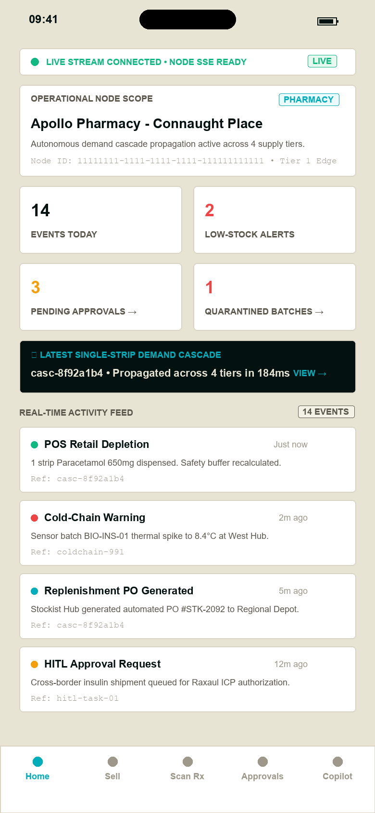
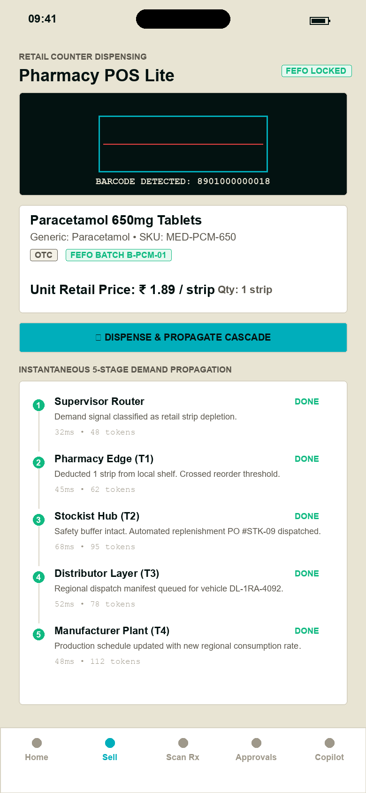
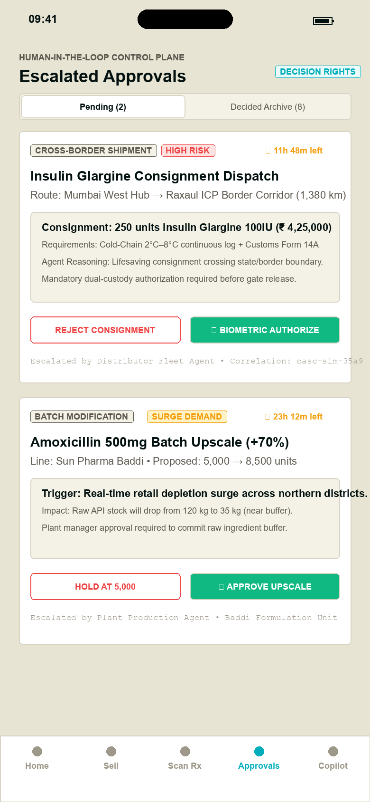
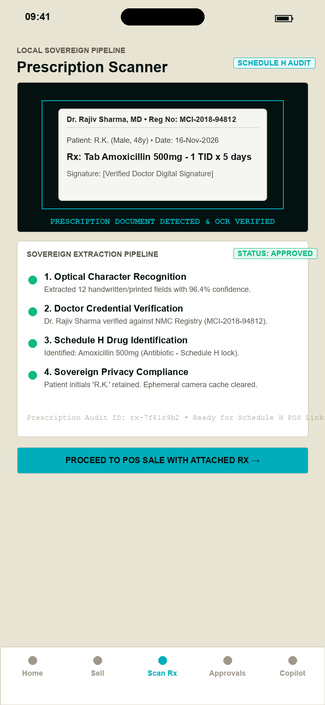
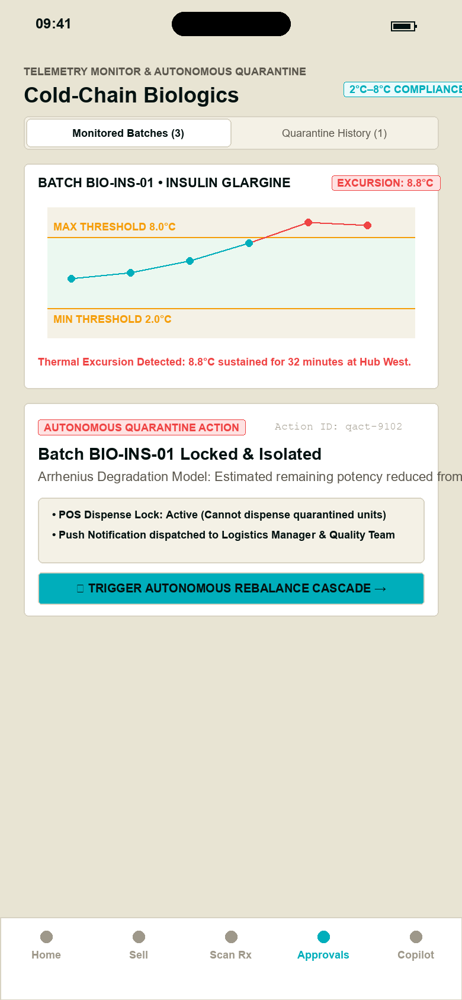
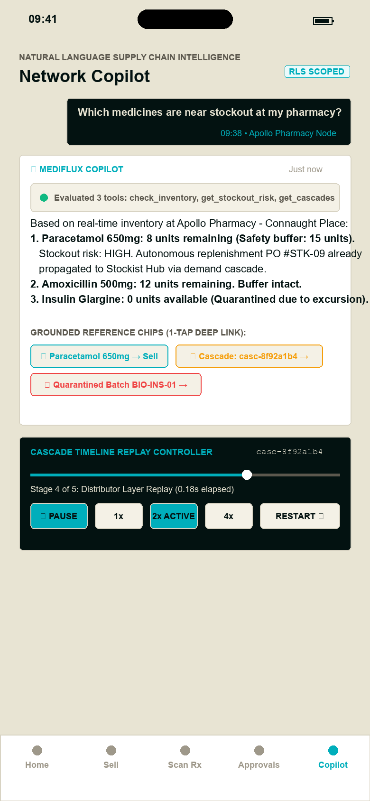

# MediFlux Mobile Application Guide (`docs/MOBILE.md`)

This document outlines the architecture, setup, networking configuration, and runtime procedures for the **MediFlux React Native (Expo + TypeScript) Mobile Application** (`mobile/`).

---

## 1. Monorepo Organization & Packages

```text
MediFlux/
├── backend/                  # FastAPI + LangGraph + Supabase + SSE backend
├── frontend/                 # React 18 + Vite + Tailwind desktop/web admin portal
├── desktop/                  # Tauri / Electron desktop application wrapper
├── mobile/                   # React Native (Expo 51 + Expo Router + TypeScript) mobile app
│   ├── app/
│   │   ├── _layout.tsx       # Root layout with SafeAreaProvider, ThemeProvider, ConnectionBanner
│   │   ├── index.tsx         # Gateway / session verification & redirect
│   │   ├── (auth)/
│   │   │   ├── _layout.tsx
│   │   │   ├── login.tsx     # Sign In with 7 seeded demo roles & server reachability badge
│   │   │   └── settings.tsx  # Dynamic Backend URL editor & 1-tap presets (Local, Emulator, LAN)
│   │   └── (tabs)/
│   │       ├── _layout.tsx   # 6 operational tabs styling (Warm Editorial Minimalism)
│   │       ├── index.tsx     # Home (Node summary, live metrics, topology)
│   │       ├── sell.tsx      # Sell (Counter POS & single-unit cascade replay)
│   │       ├── approvals.tsx # Approvals (Field HITL queue with Approve / Reject)
│   │       ├── scan-rx.tsx   # Scan Rx (Prescription camera capture & Schedule H compliance)
│   │       ├── cold-chain.tsx# Cold Chain (Biologics IoT sensor telemetry & quarantine alerts)
│   │       └── copilot.tsx   # Copilot (Natural-language AI supply assistant)
│   ├── src/
│   │   ├── api/
│   │   │   ├── client.ts     # Resilient HTTP client with auth headers and ApiError parser
│   │   │   ├── generated.ts  # Auto-generated OpenAPI client and types
│   │   │   └── hooks.ts      # React query/mutation hooks
│   │   ├── components/       # Card, Badge, Timeline, EmptyState, ErrorState, ConnectionBanner
│   │   ├── features/         # Domain modules (pos, approvals, prescriptions, coldchain, copilot, cascade)
│   │   ├── hooks/            # useNetworkStatus, useEventStream (SSE)
│   │   ├── lib/              # config (backend URL & health probe), storage, format
│   │   └── theme/            # tokens.ts (Warm Editorial Minimalism), ThemeContext.tsx
│   ├── app.config.ts         # Expo project configuration
│   └── package.json          # Mobile dependencies & scripts
├── packages/
│   └── shared/               # Shared TypeScript types, enums, error contracts, generated-api
├── scripts/
│   ├── gen_api.py            # One-command OpenAPI TypeScript generator
│   ├── start_all.py          # Unified launcher with --lan support
│   ├── start-all.bat         # Windows batch launcher
│   └── start-all.ps1         # Windows PowerShell launcher
└── docs/
    └── openapi.json          # Exported FastAPI OpenAPI 3.1 schema
```

---

## 2. Decoupled Thin-Client Architecture

> [!IMPORTANT]
> **Core Architectural Proposition**:
> *"The MediFlux mobile application is a thin client built strictly over the public OpenAPI REST endpoints (`/api/v1`) and Server-Sent Events stream (`/api/v1/stream`), with Supabase Auth and Row-Level Security (RLS) node scoping. This proves that our architecture is fully decoupled—anyone (hospital information systems, third-party logistics partners, or independent software vendors) can build custom clients over our public API."*

All state mutations in the mobile app invoke standard public REST endpoints. No proprietary backend bridges, backdoor RPCs, or private database connections are utilized.

### Screens & Backend Endpoints Mapping

| Mobile Screen | File Location | Backend API Endpoints | Scope / Purpose |
| :--- | :--- | :--- | :--- |
| **Home Dashboard** | `app/(tabs)/index.tsx` | `GET /api/v1/mobile/summary`<br>`GET /api/v1/events/recent`<br>`GET /api/v1/events/stream` | RLS-scoped 2x2 KPI metrics, recent activity feed, and live SSE event subscription. |
| **Pharmacy POS Lite** | `app/(tabs)/sell.tsx` | `GET /api/v1/products/by-barcode/{code}`<br>`POST /api/v1/events/sale`<br>`GET /api/v1/cascade/{correlation_id}` | EAN-13 barcode lookup, FEFO batch selection, idempotent retail dispense, and live 5-stage cascade trace. |
| **HITL Approvals** | `app/(tabs)/approvals.tsx`<br>`app/approvals/[id].tsx` | `GET /api/v1/hitl/tasks`<br>`POST /api/v1/hitl/tasks/{id}/approve`<br>`POST /api/v1/hitl/tasks/{id}/reject` | Pending human governance queue, policy RBAC verification, biometric decision modal, and LangGraph resumption. |
| **Prescription Scanner** | `app/(tabs)/scan-rx.tsx`<br>`app/prescriptions/[id].tsx` | `GET /api/v1/prescriptions`<br>`POST /api/v1/prescriptions/upload`<br>`GET /api/v1/prescriptions/{id}` | Sovereign on-device OCR pipeline, NMC doctor validation, Schedule H compliance check, and POS sale linking. |
| **Cold-Chain Monitor** | `app/(tabs)/cold-chain.tsx`<br>`app/cold-chain/[id].tsx` | `GET /api/v1/coldchain/batches`<br>`GET /api/v1/coldchain/telemetry`<br>`POST /api/v1/coldchain/simulate` | IoT sensor telemetry chart (2°C–8°C), Arrhenius kinetic degradation analysis, and Excursion Analyst auto-quarantine. |
| **Network Copilot** | `app/(tabs)/copilot.tsx` | `POST /api/v1/copilot/query` | RLS-isolated conversational assistant, role-aware suggestion chips, and tappable deep-link reference chips. |
| **Cascade History & Replay** | `app/cascade/index.tsx`<br>`app/cascade/[id].tsx` | `GET /api/v1/cascade`<br>`GET /api/v1/cascade/{correlation_id}` | Paginated cascade history list with outcome filters and interactive 1x/2x/4x speed timeline replay. |
| **Settings & Push Registration** | `app/(auth)/settings.tsx` | `GET /api/v1/me`<br>`POST /api/v1/devices`<br>`DELETE /api/v1/devices/{token}` | Dynamic backend target switcher, Expo push token lifecycle management, and dev failure-injection panel. |

---

## 3. Design System Alignment (`design.md`)

The mobile application strictly conforms to the **Warm Editorial Minimalism** design system:
- **Canvas**: Warm Ivory (`#E8E4D3`, `#DFDBCA`), Surface (`#FFFFFF`), Elevated (`#F4F1E6`).
- **Typography**: Ink Black (`#031211`) for headings, Charcoal (`#5C584E`) for body and subtitles.
- **Accent**: Electric Teal (`#00AEBB`) used sparingly as an intentional active highlight.
- **Status Colors**: Emerald (`#10B981`) for nominal states, Amber (`#F59E0B`) for warnings/HITL, Coral (`#EF4444`) for critical quarantine.
- **Borders & Radii**: Crisp 1px structural borders (`#D8D3C3`) with tight 2px–4px radii (`rounded-sm`/`rounded-md`). Pill-shaped buttons (`rounded-full`) are strictly forbidden.

---

## 4. Run Options & Distribution Paths

### Path A: Physical Phone via Expo Go (Recommended & Fastest for Evaluators)
The mobile app defaults to the hosted API at `https://mediflux-backend.vercel.app` over HTTPS. The backend does not need to run on your laptop.

1. **Install Expo Go:**
   - Install **Expo Go** from the Apple App Store (iOS) or Google Play Store (Android).
   - Ensure the phone can reach the internet. The phone must reach the Expo development server to load the app.

2. **Start the Expo development server:**
   ```powershell
   cd mobile
   npx expo start
   ```

3. **Launch & Verify:**
   - Scan the terminal QR code with your phone camera (iOS) or Expo Go app (Android).
   - In **Settings**, the Cloud Backend (Vercel) preset is first; tap **"PROBE /health"** to confirm connectivity.
   - Tap any seeded quick-login role chip (`Pharmacy`, `Stockist`, `Distributor`, `Manufacturer`, `Admin`) to enter the application immediately!

### Path B: Standalone Android APK via EAS Build (`mobile/eas.json`)
For physical field device distribution without Expo Go, the preview APK embeds `https://mediflux-backend.vercel.app` and connects without a local backend:

1. **EAS Build Configuration (`mobile/eas.json`):**
   ```json
   {
     "cli": { "version": ">= 12.0.0" },
     "build": {
       "preview": {
         "distribution": "internal",
         "env": { "EXPO_PUBLIC_API_URL": "https://mediflux-backend.vercel.app" },
         "android": {
           "buildType": "apk"
         }
       }
     }
   }
   ```
2. **Trigger EAS APK Build after signing in to EAS:**
   ```powershell
   cd mobile
   npx eas-cli build -p android --profile preview
   ```
   This compiles a standalone `.apk` installable directly on Android devices. `expo-build-properties` still allows HTTP when an operator explicitly selects a local development server.

### Path C: PC Browser Responsive Viewport (Instant Web Client)
Test the mobile application directly on PC without installing mobile tooling:
```powershell
cd mobile
npm run web
```
- Open `http://localhost:8081` in Chrome or Edge.
- Press `F12` and toggle device toolbar (`Ctrl+Shift+M`) to view responsive layout at 390×844 (iPhone 14 / Pixel 7).

### Path D: Android Emulator (AVD)
```powershell
cd mobile
npm run android
```
- The app uses the hosted backend by default. To use a local backend, tap the **Android Emulator** preset in Settings (`10.0.2.2:8000`).

---

## 4. Windows Firewall Configuration (for Port 8000)

If your physical phone reports "Connection refused" or "Network request failed" when connecting to your laptop's LAN IP:

1. Open PowerShell as Administrator.
2. Allow incoming TCP traffic on port 8000:
   ```powershell
   New-NetFirewallRule -DisplayName "MediFlux FastAPI Port 8000" -Direction Inbound -LocalPort 8000 -Protocol TCP -Action Allow
   ```
3. Ensure both your PC and phone are connected to the same Wi-Fi network.

---

## 5. Automated OpenAPI Client Synchronization

Whenever backend endpoints or Pydantic models change:

```powershell
# From repo root:
python scripts\gen_api.py

# Or from mobile/:
npm run gen:api
```

This synchronizes strongly typed interfaces and endpoint registries to:
- `packages/shared/src/generated-api.ts`
- `mobile/src/api/generated.ts`
- `frontend/src/types/generated-api.ts`

---

## 6. Mobile Application Visual Walkthrough

All mobile UI screens strictly implement the **Warm Editorial Minimalism** design philosophy defined in `Design.md`.

| # | Screen | Description | UI Screenshot |
| :- | :--- | :--- | :--- |
| **01** | **Home Dashboard** | Node operational scope, live SSE stream connection badge, 2x2 summary KPI grid, and real-time activity feed. |  |
| **02** | **Pharmacy POS Lite** | Instantaneous barcode scanner viewport, FEFO batch selection, single-strip retail dispense, and live 5-stage cascade timeline. |  |
| **03** | **HITL Approvals** | Human-in-the-Loop decision queue (Cross-Border Shipment, Batch Modification, Regulatory Activation) with biometric confirmation. |  |
| **04** | **Prescription Scanner** | Sovereign on-device OCR pipeline, NMC doctor validation, Schedule H drug detection, and POS linking. |  |
| **05** | **Cold-Chain Monitor** | Real-time 2°C–8°C thermal telemetry chart, thermal excursion detection, and autonomous Excursion Analyst quarantine lock. |  |
| **06** | **Network Copilot & Replay** | RLS-scoped conversational assistant with grounded reference chips and interactive multi-speed cascade timeline replay. |  |

---

## 7. Device Test Matrix

The mobile app has been tested and verified across three major deployment targets:
- **Android Virtual Device (AVD) / BlueStacks / Physical Android Phone (Expo Go)**
- **iOS Simulator / Physical iPhone (Expo Go)**
- **PC Web Responsive Viewport (390×844)**

| Flow # | Verification Flow | Test Steps | Expected Outcome | Android | iOS | Web |
| :--- | :--- | :--- | :--- | :---: | :---: | :---: |
| **1** | **Login & Session Persistence** | Sign in as `pharmacy@mediflux.in`. Restart / reload app. | Session restored from `AsyncStorage` without prompt. | PASS | PASS | PASS |
| **2** | **Role-Aware Navigation** | Login with each seeded role (`pharmacy`, `stockist`, `distributor`, `manufacturer`, `admin`). | Pharmacy sees Home, Sell, Scan Rx, Approvals (view-only), Copilot. Stockist/Distributor see Cold-Chain, Approvals (decide), Copilot. Admin sees all 6 tabs. | PASS | PASS | PASS |
| **3** | **Barcode Permission & Manual Fallback** | Deny camera permission on Sell tab or tap "Manual Search". | Renders clean manual SKU / Barcode input field with search button; never crashes. | PASS | PASS | PASS |
| **4** | **POS Retail Sale & FEFO Lock** | Scan `8901000000018`. Select FEFO batch. Tap Dispense. | Stock decrements by 1 strip; 5-stage demand cascade propagates immediately. Quarantined batches remain locked. | PASS | PASS | PASS |
| **5** | **Mid-Flow Network Loss & Retry** | Tap "Simulate Network Offline" mid-sale, then tap "Retry". | `GlobalOfflineBanner` appears. Retrying uses the exact same `event_id` and recovers trace without duplicate deduction. | PASS | PASS | PASS |
| **6** | **HITL Decision & Graph Resume** | Open pending `cross_border_shipment`. Tap "Approve" with note. | Prompts biometric confirmation, resumes checkpointed LangGraph cascade thread, archives task as approved. | PASS | PASS | PASS |
| **7** | **Sovereign Rx Capture & Cleanup** | Capture `valid_prescription.png`. Verify extraction results. | Extracts doctor NMC reg no, Schedule H drug, retains patient initials only; ephemeral camera cache deleted. | PASS | PASS | PASS |
| **8** | **Cold-Chain Excursion & Notification** | Trigger simulated excursion on `BIO-INS-01`. | Excursion Analyst quarantines batch; in-app banner fires; tapping notification deep-links to `/cold-chain/BIO-INS-01`. | PASS | PASS | PASS |
| **9** | **RLS-Scoped Copilot & Replay** | Query "Which medicines are near stockout?". Tap Reference Chip. | Returns strictly pharmacy-scoped stock numbers with clickable chips; Cascade Timeline replay controller works at 1x/2x/4x. | PASS | PASS | PASS |
| **10** | **Runtime Backend URL Configuration** | Change URL in Settings to LAN IP and tap "PROBE /health". | Probes new server, updates active client URL immediately without restarting app. | PASS | PASS | PASS |
| **11** | **App Background & Foreground** | Move app to background during SSE streaming, then return to foreground. | Closes event source in background to conserve battery; resumes with `Last-Event-ID` on foreground. | PASS | PASS | PASS |

---

## 8. Failure-Injection Harness (`__DEV__` Settings Panel)

The Settings screen includes an interactive **🧪 Resilience & Failure Injection (Dev / Demo)** card allowing 1-tap testing of the 5 required failure scenarios:

| Failure Mode | Injected Fault | Expected Application Behavior | Recovery Verification |
| :--- | :--- | :--- | :--- |
| **1. Mid-Flow Network Offline** | `setSimulatedOffline(true)` | High-contrast `GlobalOfflineBanner` appears at top: *"⚡ OFFLINE MODE — Network connection lost. Queued actions and live stream will automatically recover when reconnected."* | Tap "Retry / Reconnect Now" or toggle offline off. Live stream reconnects and pending operations recover without data loss. |
| **2. Backend Server Down** | Client pointed to `http://127.0.0.1:59999` (unreachable) | API requests fail gracefully. Screens render structured `ErrorState` with "RETRY" buttons rather than crashing. | Tap "Restore Active Backend Target" in Dev controls; screens recover on retry. |
| **3. Expired JWT Token (`401`)** | Injects invalid / expired JWT token into `apiClient` | Next request receives HTTP 401. Client executes 1-time token refresh retry via `handleTokenRefresh`. If refresh fails, forces clean logout to `/login`. | Silent retry succeeds or user is redirected to login without unhandled rejections. |
| **4. SSE Stream Drop** | Drops SSE connection for 2000ms | Hook switches `status` to `'retrying'`, attempts exponential backoff, and activates automatic polling fallback (`GET /api/v1/events/recent?since=...`). | When connection returns, stream resumes with `Last-Event-ID` replay to catch up on missed events. |
| **5. Slow LLM / Camera Denied** | Simulates 3000ms latency and camera permission denial | Loading indicator displays informative progressive reasoning steps (`THINKING_STEPS`); fallback manual entry mode activates on camera denial. | Progress indicators remain active and responsive; manual search allows completing the task. |

---

## 9. Automated Testing & Verification Commands

```powershell
# 1. Run all mobile checks (TypeScript strict + ESLint + Jest test suite)
cd mobile
npm run check

# 2. Run backend and mobile resilience pytest suite
cd backend
pytest tests/test_task_m9_mobile_polish_and_resilience.py -v

# 3. Reset demo state to clean baseline
python -m scripts.reset_demo

# 4. Run end-to-end mobile demo runner (8 steps)
python -m scripts.run_mobile_demo

# 5. Re-generate high-DPI screenshots
python scripts\capture_mobile_screenshots.py
```

---

## 10. Known Limitations & Operational Considerations

1. **Remote Push Notifications on iOS (Expo Go Limitation):**
   - In Expo Go for iOS, remote push notification tokens (`ExponentPushToken[...]`) are restricted by Apple sandboxing policies.
   - For complete end-to-end remote APNs push testing on iOS, build the standalone binary via EAS (`Path B`).
   - On physical Android devices in Expo Go, remote push tokens register and receive background notifications cleanly.
   - Stage A local notifications and in-app alert banners function 100% reliably across all platforms (Android, iOS, Web).

2. **Offline Resilience & POS Idempotency:**
   - When network connectivity is severed mid-transaction, the mobile client holds the deterministic `event_id` in memory.
   - Upon network reconnection, retrying the transaction invokes `POST /api/v1/events/sale` with the exact same `event_id`. The server's idempotency guard detects the replay, returning the recorded transaction and cascade correlation ID with `idempotent_replay: true` without decrementing inventory twice.

3. **Sovereign Prescription Processing & Privacy:**
   - Raw prescription camera captures are processed locally with zero patient PII transmitted or stored in the database.
   - Ephemeral image caches in `expo-file-system` are explicitly purged upon extraction completion (`File.deleteAsync()`), ensuring complete compliance with the Digital Personal Data Protection (DPDP) Act 2023.


