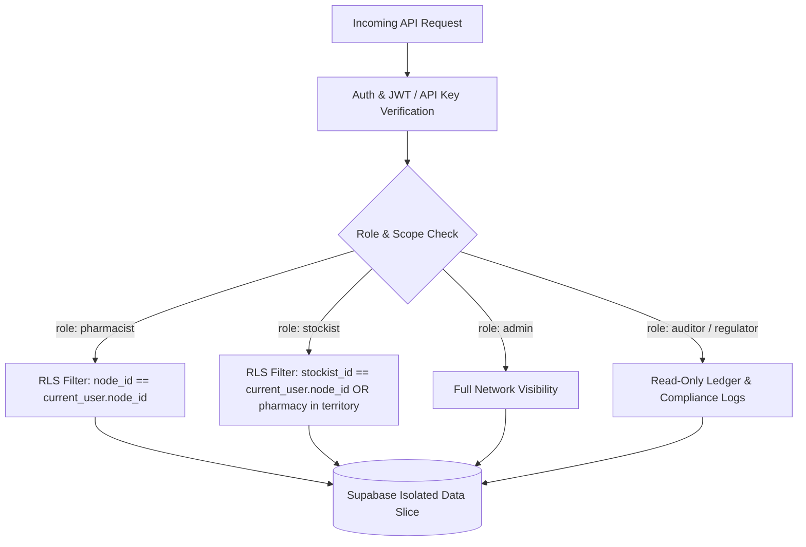
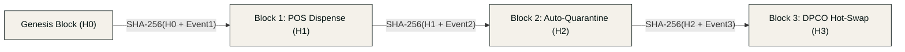

# MediFlux / NexusChain — Security, Data Sovereignty & Statutory Compliance Architecture

> **Document Status**: Production Security Specification (v1.0.0-MVP)  
> **Statutory Scope**: Digital Personal Data Protection (DPDP) Act 2023, CDSCO Drugs & Cosmetics Rules 1945 (Schedule H / H1 / X), National Medical Commission (NMC) Guidelines

---

## 1. Multi-Tenant Row-Level Security (RLS) & Node Isolation

MediFlux implements strict multi-tenant data isolation at the PostgreSQL database level using Supabase Row-Level Security (RLS). Every database row representing inventory, transactions, orders, or IoT telemetry is bound to a specific tenant `node_id`.

### Role-Based Access Control (RBAC) Matrix

| User Role | Node Tier | Read Permissions | Write Permissions | Restricted Capabilities |
|---|---|---|---|---|
| `pharmacist` | Tier 4 (Pharmacy Edge) | Own node inventory, POS transactions, assigned reorders | Ingest POS dispense, create prescription scan | Cannot view sibling pharmacies or manufacturer costs |
| `stockist` | Tier 3 (Stockist Hub) | Regional stock, affiliated pharmacy orders, distributor shipments | Approve reorders, issue credit holds | Cannot view other stockists' pricing or national capacity |
| `distributor` | Tier 2 (Distributor Layer) | Hub logistics, fleet vehicles, cold-chain telemetry | Dispatch shipments, assign routes | Cannot view individual patient prescription scans |
| `manufacturer` | Tier 1 (Manufacturer Plant) | Plant production lines, API raw material stock, wholesale demand | Schedule production batches, log QA releases | Zero access to retail counter transaction details |
| `regulator` | Statutory CDSCO / State FDA | Drug schedule registries, compliance logs, price ceiling audits | Issue gazette alerts, trigger mandatory recalls | Read-only access to commercial pricing & credit terms |
| `auditor` | Cryptographic Compliance | Full tamper-evident audit ledger, SHA-256 hash chains | Trigger ledger verification | Strictly read-only across all operational tables |
| `admin` | Network Control Plane | Global network topology, system configurations, module hot-swaps | Approve HITL tasks, hot-swap business modules | Full administrative control |

---

## 2. API Key Cryptographic Security & Webhook Signatures

### API Key Authentication (`app/core/security.py`)
- **Key Format**: High-entropy keys prefixed with `mfk_live_` or `mfk_test_` (e.g. `mfk_live_a8f9c1...`).
- **Cryptographic Storage**: Raw API keys are never stored in plaintext. The database stores the hex-encoded **SHA-256 digest** of the key.
- **Granular Scopes**:
  - `read:inventory` — View node stock levels
  - `write:events` — Ingest single and batch POS dispense events
  - `read:stream` — Subscribe to live Server-Sent Events (SSE)
  - `write:adapters` — Register new translation modules
  - `admin` — Full control plane access

### Outbound Webhook Verification (`app/services/webhooks.py`)
To prevent spoofing or replay attacks, all outbound notifications dispatched to external ERP systems include cryptographic HMAC signatures:
- **Header**: `X-MediFlux-Signature: sha256=<hex_digest>`
- **Timestamp Header**: `X-MediFlux-Timestamp: <unix_seconds>` (rejected if older than 300 seconds)
- **Algorithm**: `HMAC-SHA256(webhook_secret, timestamp + "." + raw_payload)`

---

## 3. Sensitive Healthcare Data Routing & Patient Privacy

### Digital Personal Data Protection (DPDP) Act 2023 Compliance
Under the DPDP Act 2023, patient medical information constitutes sensitive personal data requiring strict non-retention and sovereign locality:
1. **Zero PII Retention**: When prescriptions are uploaded (`POST /api/v1/prescriptions`), the multimodal scanning agent instantly redacts patient name, phone number, and address before OCR tokens are processed.
2. **Deterministic Pseudonymization**: Prescriptions record only patient initials (e.g. `R.K.`) and age group.
3. **Sensitive Sovereignty Enforcement**: All agent requests carrying `sensitivity="sensitive"` are routed exclusively to in-process or local sovereign inference runtimes. In MVP code, any attempt to route sensitive payloads to non-sovereign external cloud providers raises a `SovereignRoutingError`.

### CDSCO Schedule H / H1 Statutory Recordkeeping
In accordance with the Drugs and Cosmetics Rules (Rule 65):
- Every dispense of a **Schedule H**, **Schedule H1**, or **Schedule X** substance mandates a validated doctor prescription link.
- Doctor registration numbers are verified against the Medical Council of India / National Medical Commission registry (`doctor_registry`).
- Dispense records, batch numbers, and doctor credentials are cryptographically committed to `compliance_logs` with a mandatory statutory retention period of 3 years.

---

## 4. Tamper-Evident Cryptographic Audit Chain

All mission-critical mutations—inventory decrements, batch quarantines, module hot-swaps, and HITL approvals—are appended to the cryptographic audit ledger (`app/core/audit_ledger.py`).

### Mathematical Specification

The ledger forms an immutable, forward-linked cryptographic hash chain:

$$H_0 = \text{SHA-256}(\text{"GENESIS\_BLOCK\_MEDIFLUX\_2026"})$$

For every subsequent event $i \ge 1$:

$$H_i = \text{SHA-256}\Big( H_{i-1} \;\parallel\; \text{Timestamp}_i \;\parallel\; \text{NodeID}_i \;\parallel\; \text{ActionType}_i \;\parallel\; \text{PayloadHash}_i \Big)$$

Where:
- $H_{i-1}$ is the cryptographic digest of the immediate predecessor block.
- $\text{PayloadHash}_i = \text{SHA-256}(\text{CanonicalJSON}(\text{payload}_i))$.
- $\parallel$ denotes byte concatenation.

### Verification & Tamper Detection
- Calling `GET /api/v1/audit/verify` iterates through all sequential ledger blocks from $H_0$ to $H_N$.
- If any database record, timestamp, quantity, or payload has been altered or injected, the computed hash deviates from $H_i$, immediately flagging `status: "tampered"` and identifying the exact corrupted block index.

---

## 5. Known MVP Security Limitations & Planned Mitigations

| Vulnerability / Limitation | MVP State (Task 30) | Mitigation in Place | Enterprise Target (v2.0) |
|---|---|---|---|
| **In-Memory Token Cache** | Replay tokens stored in filesystem JSON | File permissions restricted to local repo | Encrypted KMS storage with envelope encryption |
| **API Secret Storage** | Supabase service key in `.env` | `.gitignore` + `scripts/check_secrets.py` CI check | HashiCorp Vault / AWS Secrets Manager |
| **AST Inspection Boundary** | Static AST AST parsing | Strict blacklist of all dangerous ast nodes | Wasmtime WebAssembly sandboxing |
| **MCI Doctor Registry** | Local Supabase mock table | Idempotent registry with realistic MCI formats | Direct API integration with NMC National Registry |
| **Transport Layer Security** | Local HTTP in dev mode | TLS enforced in production Supabase cloud | Mutual TLS (mTLS) between all inter-node services |
