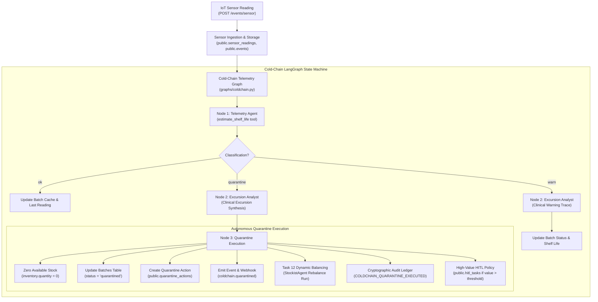

# Task 20 Specification: Cold-Chain Telemetry Graph

## 1. Overview & Objective

Task 20 implements the **Cold-Chain Telemetry Graph and Autonomous Auto-Quarantine Engine** for MediFlux (RFP Phase 4). The system ensures real-time quality assurance and patient safety for temperature-sensitive biological and cold-chain pharmaceutical products (e.g., Insulin, Vaccines, Monoclonal Antibodies).

The system monitors IoT sensor streams (temperature, humidity, mechanical shock) across **Stockist Hubs** and **Transit Shipments**, evaluates continuous degradation using a documented Arrhenius Degree-Hour and Mechanical Shock model, and autonomously enforces batch quarantines when critical thresholds are breached.

Key functional capabilities:
1. **Multi-Mode IoT Sensor Telemetry Simulator (`simulator/sensor_simulator.py`)**: Simulates `normal`, progressive `excursion`, and severe physical handling `shock` modes for hubs and shipments.
2. **Simplified Arrhenius Degree-Hour Degradation Model (`estimate_shelf_life`)**: Dynamically computes shelf-life loss from thermal excursions (heat acceleration and protein-denaturing freeze) and physical impact shocks.
3. **Tri-Node Cold-Chain LangGraph (`graphs/coldchain.py`)**:
   - `telemetry_agent_node`: Evaluates telemetry and classifies batch status into `ok`, `warn`, or `quarantine`.
   - `excursion_analyst_node`: Synthesizes clinical and supply-chain plain-language explanations with deterministic fallback templates.
   - `quarantine_execution_node`: Immediately updates batch status to `quarantined`, zeroes available inventory stock across all nodes, inserts into `public.quarantine_actions`, emits `coldchain.quarantined` events, invokes Task 12 Dynamic Balancing Agent (`StockistAgent`) to rebalance cluster inventory, and appends a SHA-256 hash-chained entry to `public.audit_ledger`.
4. **Configurable High-Value HITL Governance**: Creates pending Human-in-the-Loop review tasks in `public.hitl_tasks` when quarantined inventory exceeds monetary thresholds (`COLDCHAIN_HIGH_VALUE_HITL_THRESHOLD`), while still immediately halting retail dispensing.
5. **RESTful Telemetry & Monitoring APIs**:
   - `POST /api/v1/events/sensor`: Ingests sensor readings, executes coldchain graph, and returns evaluation.
   - `GET /api/v1/coldchain/batches`: Lists cold-chain batches enriched with available quantity, last reading, and shelf-life estimate.
   - `GET /api/v1/coldchain/quarantines`: Lists all historical quarantine actions with clinical excursion reasons and rebalance traces.

---

## 2. Architecture & Workflow

---

## 3. Mathematical Degradation Model

The tool `estimate_shelf_life` implements the **Simplified Arrhenius Degree-Hour Thermal & Mechanical Shock Degradation Model**:

### 3.1 Baseline Nominal Shelf Life
$$\text{nominal\_remaining\_days} = (\text{expiry\_date} - \text{current\_date}).\text{days}$$

### 3.2 Thermal Excursion Penalties
1. **Heat Excursion** ($\text{temperature\_c} > \text{storage\_max\_c}$):
   $$\Delta T = \text{temperature\_c} - \text{storage\_max\_c}$$
   $$\text{penalty\_days} = \left(\frac{\text{duration\_minutes}}{60.0}\right) \times \Delta T \times 0.75 \times 2^{(\Delta T / 10.0)}$$

2. **Freezing Excursion** ($\text{temperature\_c} < \text{storage\_min\_c}$):
   Biologic proteins (e.g. insulin, vaccines) denature rapidly upon freezing:
   $$\Delta T_{\text{freeze}} = \text{storage\_min\_c} - \text{temperature\_c}$$
   $$\text{penalty\_days} = \left(\frac{\text{duration\_minutes}}{60.0}\right) \times \Delta T_{\text{freeze}} \times 4.0$$

### 3.3 Mechanical Shock Penalties
1. **Moderate Shock** ($4.0g < \text{shock\_g} < 8.0g$):
   $$\text{shock\_penalty\_days} = (\text{shock\_g} - 4.0) \times 5.0$$
2. **Critical Impact Breach** ($\text{shock\_g} \ge 8.0g$):
   Critical vial integrity failure or macromolecular aggregation breach. Forces **100% shelf-life loss** (`estimated_remaining_days = 0.0`) and triggers immediate quarantine.

### 3.4 Remaining Shelf Life
$$\text{estimated\_remaining\_days} = \max\left(0.0, \text{nominal\_remaining\_days} - \sum \text{thermal\_penalties} - \sum \text{shock\_penalties}\right)$$
$$\text{shelf\_life\_pct} = \max\left(0.0, \min\left(100.0, \frac{\text{estimated\_remaining\_days}}{\text{nominal\_remaining\_days}} \times 100.0\right)\right)$$

---

## 4. REST Endpoints Specification

| Method | Endpoint | Description | Status Code |
| :--- | :--- | :--- | :--- |
| `POST` | `/api/v1/events/sensor` | Ingests sensor reading(s), persists to database, runs coldchain graph, returns evaluation | `202 Accepted` |
| `GET` | `/api/v1/coldchain/batches` | Lists all cold-chain batches with cached shelf life, available quantity, and status | `200 OK` |
| `GET` | `/api/v1/coldchain/quarantines` | Lists all quarantine actions enriched with clinical reasons and rebalancing status | `200 OK` |
| `POST` | `/api/v1/coldchain/sensor` | Direct proxy endpoint for cold-chain sensor ingestion | `202 Accepted` |

---

## 5. Lateral Rebalancing Integration (Task 12)

When a cold-chain batch is quarantined, the physical stock is zeroed out at the node (`node_id`). This creates an immediate deficit relative to safety stock levels.

The `quarantine_execution_node` automatically invokes the **Dynamic Balancing Agent** (`StockistAgent`) with:
- `stockist_id`: The affected node UUID
- `product_id`: The biologic product UUID
- `quantity`: Quarantined quantity (or replenishment threshold)
- `priority`: `"critical"`
- `is_cold_chain`: `True`
- `correlation_id`: Shared trace ID

The balancing run executes cluster inventory verification, discovers peer stockist surplus or issues an escalation purchase order to the parent distributor, and records full telemetry in `public.agent_runs` under `agent_name="stockist_agent"` and `correlation_id`.

---

## 6. Verification Matrix

| Checkpoint | Test Case | Target Assertion | Status |
| :--- | :--- | :--- | :--- |
| **Model Verification** | `test_arrhenius_and_shock_degradation_formula` | Mathematical accuracy for heat, freeze, and shock penalties | Passed |
| **Normal Readings** | `test_normal_readings_acceptance` | Batch remains active, available stock unchanged, decision `ok` | Passed |
| **Excursion Quarantine** | `test_thermal_excursion_quarantine_and_stock_removal` | Auto-quarantine, available stock = 0, audit log recorded | Passed |
| **Mechanical Shock** | `test_mechanical_shock_breach_quarantine` | Shock $\ge 8.5g$ triggers quarantine, 100% shelf-life loss | Passed |
| **Rebalance Trace** | `test_rebalancing_activity_visible_in_trace` | `agent_runs` contains telemetry_agent, excursion_analyst, stockist_agent | Passed |
| **High-Value HITL** | `test_high_value_hitl_quarantine_policy` | Creates pending HITL task while immediately quarantining batch | Passed |
| **Simulator Integration**| `test_sensor_simulator_integration` | End-to-end simulation across normal and excursion modes | Passed |
