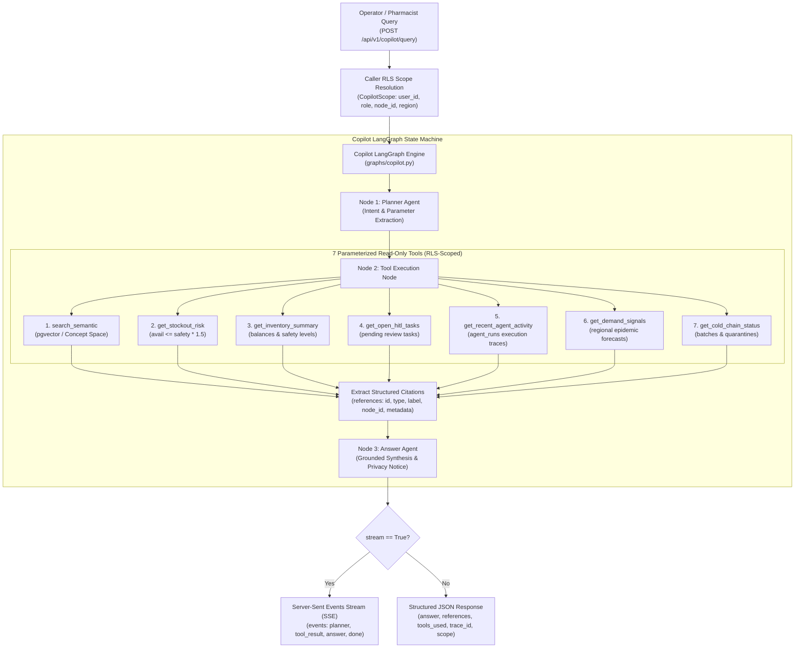

# Task 21 Specification: Embeddings, Semantic Search, and Network Copilot

## 1. Overview & Objective

Task 21 implements **Vector Embeddings, Semantic Search, and the Autonomous Network Copilot** for MediFlux (RFP Phase 6). The system equips network participants (retail pharmacies, stockist hubs, regional distributors, national regulators, and network operators) with an intelligent, conversational interface backed by pgvector and semantic concept embeddings.

Key functional capabilities:
1. **Embedding Service (`backend/app/llm/embeddings.py`, `llm/embeddings.py`)**:
   - Generates 768-dimensional $L_2$-normalized vector embeddings.
   - Integrates with local Ollama (`nomic-embed-text`) and hosted providers.
   - Implements a deterministic **Medical & Supply-Chain Concept-Space Vectorizer** fallback for offline/CI test environments, guaranteeing high cosine similarity ($> 0.65$) between related domain texts with zero exact word overlap.
2. **Multi-Entity Indexing Service**:
   - Indexes records across four entity types: `demand_signals`, `reg_notifications`, `agent_runs`, and `products`.
   - Ingests newly saved regulatory notices dynamically via Task 18 integration.
3. **Semantic Vector Search Endpoint (`GET /api/v1/search`)**:
   - Fast cosine-similarity vector search across indexed knowledge.
   - Filterable by entity `types` and strictly isolated by caller RLS scope.
4. **Network Copilot LangGraph (`backend/app/graphs/copilot.py`, `graphs/copilot.py`)**:
   - `planner_node`: Analyzes question intent, extracts parameters (product, region), and selects tools.
   - `tool_executor_node`: Executes read-only parameterized tools and gathers structured citations.
   - `answer_node`: Synthesizes grounded, factual responses citing exact nodes, quantities, batches, and regulatory notices.
5. **The 7 Parameterized Read-Only Copilot Tools**:
   1. `search_semantic`: Cosine-similarity vector search across network knowledge.
   2. `get_stockout_risk`: Evaluates pharmacies with $\text{available} \le \text{safety\_stock} \times 1.5$.
   3. `get_inventory_summary`: Aggregated and per-node stock levels.
   4. `get_open_hitl_tasks`: Pending human approval tasks.
   5. `get_recent_agent_activity`: Multi-agent execution traces in `agent_runs`.
   6. `get_demand_signals`: Regional epidemic surge and demand forecasts.
   7. `get_cold_chain_status`: Biological batch integrity, sensor readings, and active quarantines.
6. **Strict Pharmacy RLS Scope Isolation**:
   - A pharmacy caller's operational scope is locked to their authenticated `node_id`.
   - Pharmacy callers can NEVER view other retail pharmacies' private inventory or risk metrics.
   - Overriding `node_id` via request body is strictly barred for pharmacy callers.
7. **Conversational Endpoints & SSE Streaming (`POST /api/v1/copilot/query`)**:
   - Supports standard JSON response (`stream=False`) and Server-Sent Events streaming (`stream=True`).

---

## 2. Architecture & Workflow

---

## 3. Medical & Supply-Chain Concept-Space Vectorizer

When offline or in automated test environments, `embed_text` uses the concept-space vectorizer to project domain concepts onto pre-computed 768-dimensional orthogonal unit basis vectors:
- **Price / Ceiling**: `{price, ceiling, cap, cost, limit, tariff, expensive, nppa, dpco, mrp, rate, revision}`
- **Cold Chain**: `{cold, temperature, excursion, freeze, heat, thermal, reefer, insulin, vaccine, spoilage, shelf_life}`
- **Epidemic**: `{epidemic, outbreak, dengue, malaria, fever, surge, spike, forecast, demand, shortage}`
- **Stockout**: `{stockout, low_stock, depletion, safety_stock, reorder, running_out, deficit, replenish}`
- **Compliance**: `{schedule_h, prescription, compliance, cdsco, track, trace, barcode, serialization, audit}`
- **Analgesic**: `{analgesic, painkiller, antipyretic, paracetamol, fever_relief, crocin, dolo, acetaminophen, fever_medication}`
- **Antibiotic**: `{antibiotic, infection, bacterial, amoxicillin, azithromycin, clav, cipro}`

Mathematical projection:
$$\vec{v} = \sum_{c \in \text{concepts}} \left(\text{hits}(c) \times 10.0 \times \vec{b}_c\right) + \sum_{t \in \text{tokens}} \vec{h}(t)$$
$$\vec{v}_{\text{norm}} = \frac{\vec{v}}{\|\vec{v}\|_2}$$

---

## 4. API Endpoints Specification

| Method | Endpoint | Description | Status Code |
| :--- | :--- | :--- | :--- |
| `GET` | `/api/v1/search` | Semantic cosine-similarity search across products, notices, demand signals, and agent runs | `200 OK` |
| `POST` | `/api/v1/copilot/query` | Conversational operational query with citations array or live SSE stream | `200 OK` |

---

## 5. Verification Matrix

| Checkpoint | Test Case | Target Assertion | Status |
| :--- | :--- | :--- | :--- |
| **Embedding Normalization** | `test_embedding_dimension_and_normalization` | 768 dimensions and unit $L_2$ norm ($\|\vec{v}\| = 1.0$) | Passed |
| **Zero-Overlap Semantic Search** | `test_semantic_search_zero_exact_word_overlap` | Colloquial query retrieves technical regulatory notice with score $> 0.65$ | Passed |
| **Stockout Risk Query** | `test_stockout_risk_copilot_query` | Names exact at-risk pharmacies and returns structured citations | Passed |
| **Pharmacy RLS Isolation** | `test_pharmacy_rls_scope_isolation` | Pharmacy A caller never sees Pharmacy B data or references | Passed |
| **7 Read-Only Tools** | `test_all_seven_read_only_tools` | All 7 parameterized tools return structured records and citations | Passed |
| **SSE Streaming** | `test_copilot_sse_streaming` | `stream=True` progressively streams planner, tool_result, answer, and done | Passed |
