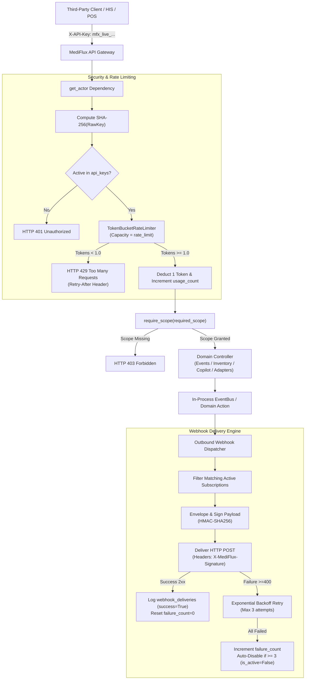

# Task 22 Specification: API Keys, Scopes, Webhooks, and Sample Third-Party Client

## 1. Overview & Objective

Task 22 delivers the **Developer Platform, Third-Party Extensibility, and Event Webhooks Engine** for MediFlux (RFP Phase 6). The system allows external healthcare systems, retail pharmacy management systems, hospital ERPs, and cold-chain logistics IoT aggregators to interact securely and autonomously with the MediFlux sovereign network.

Key functional capabilities:
1. **Scoped SHA-256 API Keys (`backend/app/services/api_keys.py`)**:
   - Cryptographically random keys (`f"mfx_live_{secrets.token_urlsafe(24)}"`).
   - Plaintext key returned **once and only once** upon generation.
   - SHA-256 hashed at rest (`key_hash`). Plaintext keys are never stored.
   - Associated with key prefix (`mfx_live_a1b2`), scopes, rate limit, usage counter, and optional node RLS binding.
2. **Canonical Developer Scopes**:
   - `read:inventory`: Access to node/network inventory, batches, and safety stock.
   - `write:events`: Ingestion of retail POS sales, sensor readings, and domain events.
   - `read:stream`: Subscription to live Server-Sent Events (SSE) topic streams.
   - `read:audit`: Inspection of hash-chained audit ledger and compliance logs.
   - `use:copilot`: Queries to Network Copilot and semantic search.
   - `manage:adapters`: Autonomous Adapter Forge synthesis, testing, and ingestion.
   - `*` or `all`: Unrestricted access.
3. **In-Memory Token-Bucket Rate Limiter**:
   - Thread/async-safe in-memory rate limiter per API key.
   - Burst capacity equal to configured `rate_limit` (req/min), refill rate equal to $\frac{\text{rate\_limit}}{60.0}$ tokens/s.
   - Rejects burst exceedance with HTTP `429 Too Many Requests` including `Retry-After` and `X-RateLimit-*` headers.
   - Explicitly documents in-memory per-process architecture due to Redis MVP deferral.
4. **Outbound HMAC-SHA256 Webhook Delivery Engine (`backend/app/services/webhooks.py`)**:
   - Supported canonical event types: `order.created`, `shipment.dispatched`, `batch.quarantined`, `hitl.created`, `hitl.decided`, `module.activated`, `*`.
   - Standard payload envelope with `delivery_id`, `event_id`, `event_type`, `timestamp`, `node_id`, `data`.
   - HMAC-SHA256 signature in `X-MediFlux-Signature: sha256={digest}` header.
   - Constant-time verification helper `verify_webhook_signature`.
   - Exponential backoff retries (3 attempts) with per-attempt logging in `webhook_deliveries`.
   - Automatic deactivation (`is_active = False`) after consecutive failed deliveries.
5. **Sample Third-Party Client (`clients/sample_client/`)**:
   - `typed_client.py`: Typed async Python SDK (`MediFluxClient`).
   - `client.py`: Runnable end-to-end 6-step flow with an embedded lightweight local webhook receiver and signature verification.
   - `README.md`: Developer onboarding documentation and quickstart instructions.
6. **OpenAPI & Developer Documentation**:
   - Enriched OpenAPI schema with `BearerAuth` and `ApiKeyAuth` security schemes.
   - Comprehensive production-grade `docs/API_GUIDE.md`.

---

## 2. Architecture & Data Flow

---

## 3. Endpoints Implemented

| Method | Endpoint | Description | Scope / Auth |
|---|---|---|---|
| `POST` | `/api/v1/developer/keys` | Provision new scoped API key (returns plaintext once) | Admin / Developer / Node Operator |
| `GET` | `/api/v1/developer/keys` | List active API keys without hashes or plaintext | Scoped to caller |
| `DELETE` | `/api/v1/developer/keys/{id}` | Revoke/deactivate API key | Admin / Developer |
| `POST` | `/api/v1/developer/webhooks` | Register outbound webhook subscription | Admin / Developer |
| `GET` | `/api/v1/developer/webhooks` | List active webhook subscriptions | Scoped to caller |
| `DELETE` | `/api/v1/developer/webhooks/{id}` | Deactivate webhook subscription | Admin / Developer |
| `GET` | `/api/v1/developer/webhooks/deliveries` | List recent webhook delivery logs | Admin / Developer |
| `POST` | `/api/v1/developer/webhooks/{id}/test` | Trigger signed test webhook delivery | Admin / Developer |
| `POST` | `/api/v1/events` | Canonical event ingestion | `write:events` |
| `POST` | `/api/v1/events/sale` | POS dispense ingestion | `write:events` |
| `GET` | `/api/v1/inventory` | Scoped inventory stock query | `read:inventory` |
| `GET` | `/api/v1/stream` | Real-time Server-Sent Events stream | `read:stream` |
| `GET` | `/api/v1/audit/ledger` | Audit ledger query | `read:audit` |
| `POST` | `/api/v1/copilot/query` | Network Copilot conversational query | `use:copilot` |
| `POST` | `/api/v1/adapters/generate` | Autonomous Adapter synthesis | `manage:adapters` |

---

## 4. Verification & Testing

The implementation is verified via `backend/tests/test_task22_developer_platform.py`:
1. Plaintext API key returned once; stored as SHA-256 hash in storage/db; never exposed on GET.
2. Scope enforcement: `read:inventory` key receives `403 Forbidden` on POS sale ingestion; key with `write:events` succeeds (`202 Accepted`) and increments `usage_count` / updates `last_used`.
3. Token-Bucket rate limiter: key with `rate_limit=3` allows 3 rapid requests and returns `429 Too Many Requests` on the 4th request with `Retry-After` header.
4. Webhook delivery and HMAC-SHA256 signature verification (`verify_webhook_signature`).
5. Webhook retry with exponential backoff and auto-disable after consecutive failed deliveries.
6. Sample third-party client end-to-end execution (`run_sample_client_flow`).
