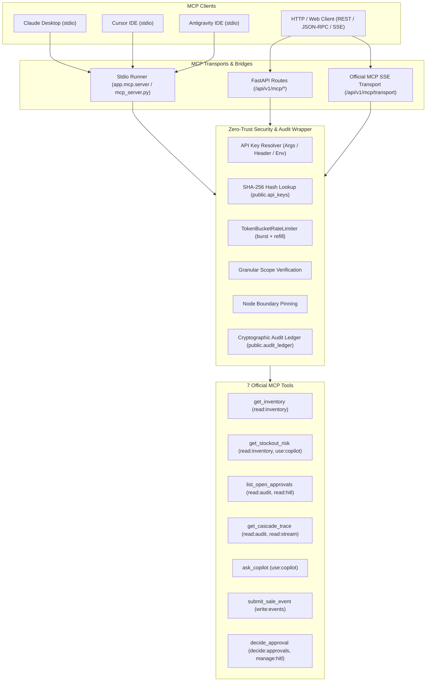

# Task 23 Specification: Model Context Protocol (MCP) Server (Stretch Goal)

## 1. Overview & Objectives

Task 23 implements the **Model Context Protocol (MCP) Server** for the MediFlux sovereign pharmaceutical supply chain network. The MCP server enables external AI coding assistants and autonomous agents (such as **Claude Desktop**, **Cursor IDE**, **Antigravity IDE**, and third-party LangGraph/AutoGen agents) to inspect real-time network stock, observe autonomous multi-tier demand cascades, query the Network Copilot, ingest point-of-sale dispense events, and process Human-in-the-Loop approval workflows.

All interactions are secured through the Developer Platform foundation built in Task 22:
- **Authentication**: Scoped SHA-256 API keys (`mfx_live_...`).
- **Authorization**: Fine-grained scope checking (`read:inventory`, `write:events`, `use:copilot`, `read:audit`, `decide:approvals`).
- **Data Isolation**: Node-level Row-Level Security (RLS) scoping pinning pharmacy keys to their specific `node_id`.
- **Throttling**: In-memory Token-Bucket rate limiting returning HTTP 429 and `Retry-After`.
- **Accountability**: Full cryptographic audit ledger logging in `public.audit_ledger` for both successful executions and security rejections.

---

## 2. Architecture & Components

---

## 3. Tool Specifications & Scope Enforcement

### 1. `get_inventory`
- **Required Scope**: `read:inventory` (or `*`)
- **Parameters**: `api_key: Optional[str]`, `node_id: Optional[str]`, `product: Optional[str]`, `region: Optional[str]`, `limit: int = 50`
- **Behavior**: Retrieves real-time stock balances, batch allocations, and safety thresholds. When an API key has a bound `node_id`, it strictly overrides any caller-supplied `node_id`.

### 2. `get_stockout_risk`
- **Required Scope**: `read:inventory` or `use:copilot`
- **Parameters**: `api_key: Optional[str]`, `product: Optional[str]`, `region: Optional[str]`
- **Behavior**: Delegates to `app.graphs.copilot.get_stockout_risk` with the caller's `CopilotScope` to detect nodes running below safety margins.

### 3. `list_open_approvals`
- **Required Scope**: `read:audit`, `read:hitl`, or `manage:hitl`
- **Parameters**: `api_key: Optional[str]`, `status: str = "pending"`, `task_type: Optional[str]`, `limit: int = 25`
- **Behavior**: Queries open HITL tasks from memory and Supabase database scoped to the caller's node RLS boundary.

### 4. `get_cascade_trace`
- **Required Scope**: `read:audit` or `read:stream`
- **Parameters**: `api_key: Optional[str]`, `correlation_id: str`
- **Behavior**: Retrieves chronological multi-tier demand cascade execution steps across agent runs, events, and audit ledgers.

### 5. `ask_copilot`
- **Required Scope**: `use:copilot`
- **Parameters**: `api_key: Optional[str]`, `question: str`, `region: Optional[str]`
- **Behavior**: Invokes the conversational Network Copilot LangGraph graph (`run_copilot`), returning answers with grounded citations.

### 6. `submit_sale_event`
- **Required Scope**: `write:events`
- **Parameters**: `api_key: Optional[str]`, `product_id: Optional[str]`, `sku: Optional[str]`, `quantity: int = 1`, `node_id: Optional[str]`, `prescription_id: Optional[str]`, `unit_price: Optional[float]`, `correlation_id: Optional[str]`
- **Behavior**: Atomic POS retail sale ingestion. If the key is bound to a pharmacy `node_id`, passing a different `node_id` is rejected with `403 Forbidden` and audited as `node_mismatch`.

### 7. `decide_approval`
- **Required Scope**: `decide:approvals` or `manage:hitl`
- **Parameters**: `api_key: Optional[str]`, `task_id: str`, `decision: Literal["approved", "rejected"]`, `decision_note: Optional[str]`
- **Behavior**: High-privilege action. Resolves the pending HITL task in `hitl_tasks`, writes a cryptographic audit entry, and resumes any waiting LangGraph thread. Governed by configuration flag `MCP_ALLOW_DECIDE_APPROVAL` (default True).

---

## 4. Cryptographic Audit Ledger Mapping

Every MCP request records a deterministic entry in `public.audit_ledger`:
- **Unauthorized Call (401)**:
  `action="mcp.tool.unauthorized"`, `status="rejected"`, `reason="invalid_or_missing_api_key"`
- **Rate Limited Call (429)**:
  `action="mcp.tool.rate_limited"`, `status="rejected"`, `reason="rate_limit_exceeded"`
- **Forbidden Scope Call (403)**:
  `action="mcp.tool.forbidden"`, `status="rejected"`, `reason="insufficient_scope"`, recording `required_scope` and caller's `key_scopes`.
- **Cross-Node Boundary Violation (403)**:
  `action="mcp.tool.forbidden"`, `status="rejected"`, `reason="node_mismatch"`, recording `node_id` and `attempted_node_id`.
- **Successful Execution (200)**:
  `action="mcp.tool.executed"`, `status="succeeded"`, recording sanitized arguments (with `api_key` redacted) and node context.

---

## 5. Verification & Acceptance Criteria

All 6 checkpoints defined in `tasks/task_23_prompt.md` verified:
1. **SDK & Architecture**: Official `mcp` 2.3.0 SDK integrated with both stdio and HTTP/SSE transports.
2. **Tool Listing**: All 7 tools listed with valid JSON schemas across REST (`/api/v1/mcp/tools`), JSON-RPC (`tools/list`), and MCP SDK (`mcp_server.list_tools()`).
3. **Valid Execution**: `get_inventory` returns node-scoped balances and logs `mcp.tool.executed` audit entry.
4. **Scope Rejection**: Read-only keys attempting `submit_sale_event`, `ask_copilot`, or `decide_approval` are rejected with 403 and logged as `mcp.tool.forbidden`.
5. **Full Tool Suite**: High-privilege keys execute all 7 tools cleanly.
6. **Zero Regressions**: 100% test pass rate across backend suite and clean linter / frontend build.
